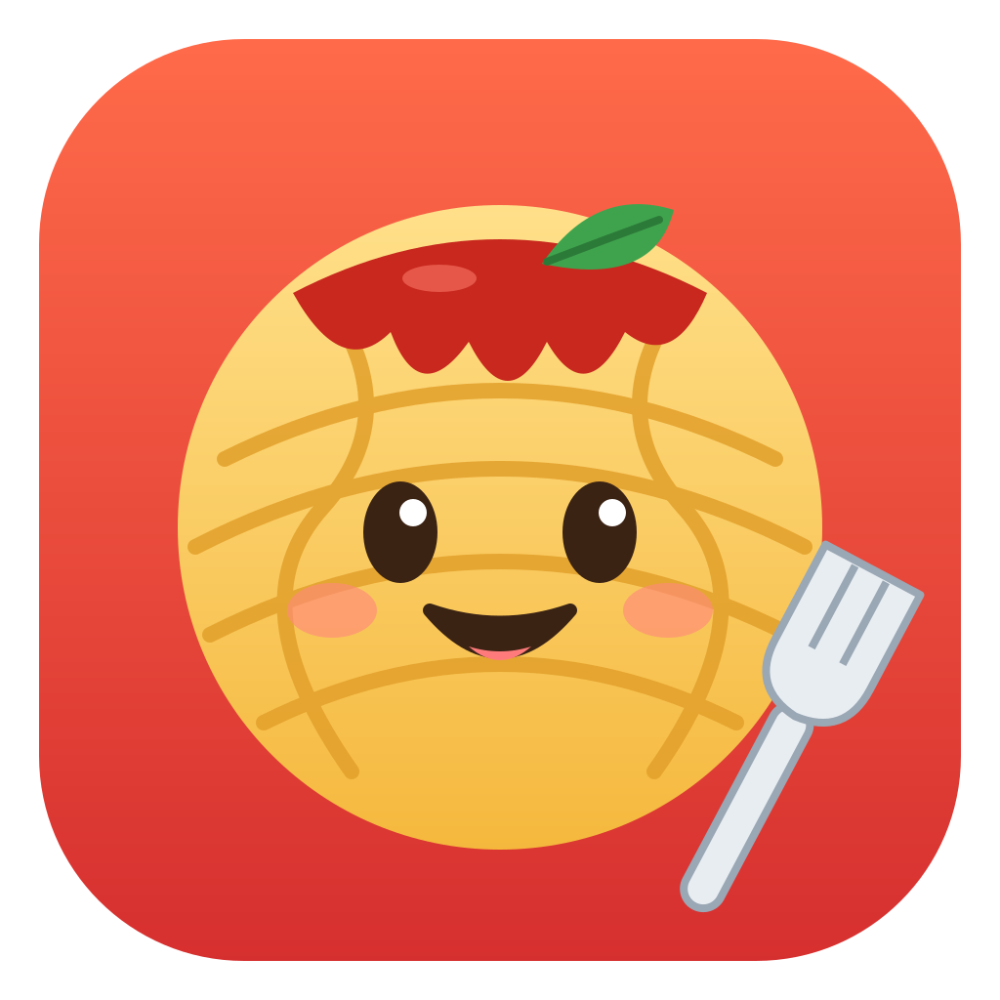

<p align="center"></p>

# Pasteroni

A tiny, native clipboard history manager for the macOS menu bar. Written in Swift/AppKit/SwiftUI, no dependencies.

## Features
- Saves text you copy, labeled Text / URL / Code, with source app and time ago
- `Ctrl+Space` opens the panel; type to search
- `↑`/`↓` to navigate, `Enter` to select, `⌘1`–`⌘0` to pick one of the first ten clips
- Selecting a clip puts it on the clipboard; you paste with `⌘V`
- Pin, rename, edit, delete (right-click a clip)
- Private Mode, history limit, excluded apps (right-click the menu bar icon)
- Ignores concealed/transient clipboard content (e.g. password managers)

## Build
Requires macOS 13+ and Xcode command line tools.

```sh
./build.sh
open Pasteroni.app
```

History is stored in `~/Library/Application Support/Pasteroni/history.json` (plain text, unencrypted).

## License
MIT
